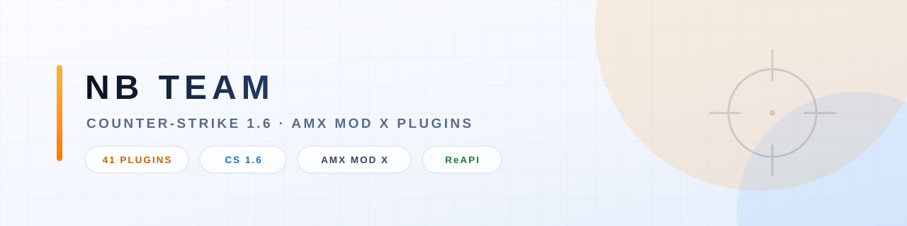

<p align="center">
  <picture>
    <source media="(prefers-color-scheme: dark)" srcset="assets/banner-dark.svg">
    <source media="(prefers-color-scheme: light)" srcset="assets/banner-light.svg">
    
  </picture>
</p>

<h1 align="center">Плагины NB Team для Counter-Strike 1.6</h1>

<p align="center">
  <b>41 серверный плагин</b> для AMX Mod X 1.9 / 1.10: экономика, магазин, ранги, скины,<br>
  админ-меню, кастомные модели и геймплейные механики.
</p>

<p align="center">
  <a href="https://drive.google.com/file/d/1Eq8Eurir6H6wmOZ7ZsqVgExlXtqBBxmJ/view?usp=sharing">
    
  </a>
</p>

<p align="center">
  
  
  
  
  
</p>

<p align="center">
  <a href="#-скачать-готовую-сборку-сервера">Скачать сборку</a> ·
  <a href="#-каталог-плагинов">Каталог плагинов</a> ·
  <a href="#-установка">Установка</a> ·
  <a href="#-сборка-из-исходников">Сборка</a> ·
  <a href="#-база-данных">База данных</a> ·
  <a href="#-лицензия">Лицензия</a>
</p>

---

## 📦 Скачать готовую сборку сервера

<p align="center">
  <a href="https://drive.google.com/file/d/1Eq8Eurir6H6wmOZ7ZsqVgExlXtqBBxmJ/view?usp=sharing">
    <b>⬇ public_server.7z — 661 МиБ</b>
  </a>
</p>

В архиве — готовый сервер CS 1.6:

| Компонент | Описание |
|---|---|
| **Linux-версия** | Финальная сборка, которая работала на хостинге (ReHLDS + ReGameDLL + Metamod + AMXX) |
| **Windows-версия** | Dev/test-сборка для разработки и локальных тестов |
| **MySQL-дамп** | Структура базы без данных |
| **README** | Подробная инструкция по установке, MySQL, портам и FastDL |

**Контрольная сумма архива:**

```text
SHA256  C8624CFB852F5003151B1B053013011B98FA2D83018E7635BBE871711AA54B78
```

> В репозитории хранятся только плагины. Полный сервер скачивается по ссылке выше.

---

## ✨ Что в репозитории

| Папка / файл | Назначение |
|---|---|
| `scripting/` | Исходники плагинов (`*.sma`), 41 шт. |
| `plugins/` | Готовые скомпилированные `*.amxx` (AMXX compiler 1.9.0.5249) |
| `assets/` | Баннеры оформления |
| `CREDITS.md` | Авторы и благодарности |
| `LICENSE` | Лицензия MIT |

Все плагины написаны под **AMX Mod X 1.9 / 1.10** и частично используют **ReAPI**, **MySQL/SQLite** и сторонние include-файлы.

---

## 📚 Каталог плагинов

<details>
<summary><b>💰 Экономика, магазин и прогрессия — 13 плагинов</b></summary>

| Плагин | Название | Версия | Зависимости |
|---|---|---|---|
| [`points_core.sma`](scripting/points_core.sma) | Points Core | 1.5-SMARTSAVE | amxmodx, sqlx |
| [`points_transfer.sma`](scripting/points_transfer.sma) | Points Transfer | 2.1 | amxmodx, amxmisc, colorchat |
| [`shop_core.sma`](scripting/shop_core.sma) | Universal Shop Core | 1.5 | amxmodx, amxmisc, colorchat, engine |
| [`shop_healthnade.sma`](scripting/shop_healthnade.sma) | Shop: Extended | 1.5 | amxmodx, amxmisc, colorchat, engine, hamsandwich, healthnade, reapi |
| [`resource_inventory.sma`](scripting/resource_inventory.sma) | Resource Inventory System | 2.1 | amxmodx, amxmisc, sqlx |
| [`seller_brain.sma`](scripting/seller_brain.sma) | Seller Brain | 3.0 | amxmodx, amxmisc, reapi |
| [`craft_system.sma`](scripting/craft_system.sma) | Craft System Framework | 2.0 | amxmodx, amxmisc, fun, hamsandwich, sqlx |
| [`skin_core.sma`](scripting/skin_core.sma) | Skin Core Pro | 2.4-BUYABLE | amxmodx, amxmisc, fakemeta, hamsandwich, reapi, sqlx |
| [`skin_shop.sma`](scripting/skin_shop.sma) | Skin Shop Menu | 1.9-PREFIX | amxmodx, amxmisc, colorchat, reapi |
| [`weapon_skin.sma`](scripting/weapon_skin.sma) | Weapon Skins Shop | 4.1 | amxmodx, amxmisc, fakemeta, hamsandwich, reapi, sqlx |
| [`skills_system.sma`](scripting/skills_system.sma) | Skills System | 2.6.0 | amxmodx, amxmisc, fakemeta, reapi, sqlx |
| [`prefix_system.sma`](scripting/prefix_system.sma) | Database & Ini Chat Prefix | 3.5 | amxmodx, sqlx |
| [`betting.sma`](scripting/betting.sma) | Betting System | 3.0-RECONNECT | amxmodx, amxmisc, fun, hamsandwich, sqlx, string |

</details>

<details>
<summary><b>🏆 Ранги, статистика и логи — 4 плагина</b></summary>

| Плагин | Название | Версия | Зависимости |
|---|---|---|---|
| [`ranks_system.sma`](scripting/ranks_system.sma) | Ranks System | 2.4-RECONNECT | amxmodx, amxmisc, reapi, sqlx |
| [`stats_advanced.sma`](scripting/stats_advanced.sma) | Advanced Stats MySQL | 1.7 | amxmodx, amxmisc, fakemeta, hamsandwich, sqlx |
| [`ChatLogger.sma`](scripting/ChatLogger.sma) | Chat Logger | 1.3 | amxmodx, sqlx |
| [`cs16_authid_audit.sma`](scripting/cs16_authid_audit.sma) | CS 1.6 AuthID Audit | 1.0 | amxmodx |

</details>

<details>
<summary><b>🛠 Администрирование и меню — 16 плагинов</b></summary>

| Плагин | Название | Версия | Зависимости |
|---|---|---|---|
| [`advanced_admin_menu.sma`](scripting/advanced_admin_menu.sma) | Advanced Admin Menu | 2.7 | amxmodx, amxmisc, engine, hamsandwich, reapi, sqlx |
| [`admin_screamer.sma`](scripting/admin_screamer.sma) | Admin Screamer Instant | 2.1 | amxmodx, amxmisc, fakemeta |
| [`devmenu.sma`](scripting/devmenu.sma) | Developer Menu Structured | 2.6 | amxmodx, reapi |
| [`dev_resource_tester.sma`](scripting/dev_resource_tester.sma) | Dev Resource Menu | 1.0 | amxmodx, amxmisc |
| [`d_alpha.sma`](scripting/d_alpha.sma) | Alpha Menu System | 2.8 | amxmodx, amxmisc |
| [`d_beta.sma`](scripting/d_beta.sma) | Beta Menu System | 2.8 | amxmodx, amxmisc |
| [`d_delta.sma`](scripting/d_delta.sma) | Delta Menu System | 2.8 | amxmodx, amxmisc |
| [`d_epsilon.sma`](scripting/d_epsilon.sma) | Epsilon Menu System | 2.8 | amxmodx, amxmisc |
| [`d_gamma.sma`](scripting/d_gamma.sma) | Gamma Menu System | 2.8 | amxmodx, amxmisc |
| [`d_zeta.sma`](scripting/d_zeta.sma) | Zeta Menu System | 2.8 | amxmodx, amxmisc |
| [`map_brightness.sma`](scripting/map_brightness.sma) | Map Brightness Menu | 1.1 | amxmodx, amxmisc, engine |
| [`graphics_settings.sma`](scripting/graphics_settings.sma) | Graphics Settings | 1.7_no_cstrike | amxmodx, fakemeta, hamsandwich, reapi |
| [`resetsTab.sma`](scripting/resetsTab.sma) | Reset Score | 1.1 | amxmodx, fakemeta, fun |
| [`test_menu_bypass.sma`](scripting/test_menu_bypass.sma) | Test Menu Bypass | 1.1 | amxmodx |
| [`test_privilege.sma`](scripting/test_privilege.sma) | Test Privilege (1 day) | 1.3 | amxmodx, amxmisc, sqlx |
| [`speedometr.sma`](scripting/speedometr.sma) | ReAPI Speedometer | 1.3 | amxmodx, reapi |

</details>

<details>
<summary><b>🎮 Геймплей — 8 плагинов</b></summary>

| Плагин | Название | Версия | Зависимости |
|---|---|---|---|
| [`freeguns.sma`](scripting/freeguns.sma) | Respawn Weapon Menu + Armor & Nades | 1.1 | amxmodx, reapi |
| [`parachute_for_all_reapi.sma`](scripting/parachute_for_all_reapi.sma) | Parachute for ALL [ReAPI] | 3.1 | amxmodx, engine, reapi |
| [`chat_teams.sma`](scripting/chat_teams.sma) | Chat Team Changer (ReAPI) | 2.9-SmartBalance | amxmodx, reapi |
| [`livesSystem.sma`](scripting/livesSystem.sma) | Lives System | 1.6.1 | amxmodx, colorchat, fakemeta, reapi |
| [`trigger_test.sma`](scripting/trigger_test.sma) | Trigger System Test | 1.4 | amxmodx, amxmisc, engine, fakemeta, fun |
| [`custom_models_manager.sma`](scripting/custom_models_manager.sma) | Custom Models & Triggers Pro | 7.0 | amxmodx, amxmisc, engine, fakemeta, fun, hamsandwich, xs |
| [`anti_dem_pw_sniffer.sma`](scripting/anti_dem_pw_sniffer.sma) | Anti Demo PW Sniffer | 1.0.4 | amxmodx, reapi |
| [`semiclip.sma`](scripting/semiclip.sma) | Team Semiclip | 1.1 | amxmodx, fakemeta |

</details>

> `parachute_for_all_reapi.sma` — совместная работа: **Leo_[BH] & nb_team**.
>
> Плагины `d_*`, `dev*`, `test_*`, `trigger_test` — служебные/тестовые и могут быть не нужны на публичном сервере.

---

## ⚙️ Требования

- **AMX Mod X 1.9** или **1.10**.
- Модули AMXX: `fakemeta`, `engine`, `fun`, `hamsandwich`, `sqlx`, `mysql` и/или `sqlite`.
- [**ReAPI**](https://github.com/s1lentq/reapi) — для плагинов с `reapi`.
- Сторонние include-файлы, которых нет в стандартной поставке AMXX:
  - `colorchat.inc` — `points_transfer`, `shop_core`, `shop_healthnade`, `skin_shop`, `livesSystem`;
  - `healthnade.inc` — `shop_healthnade`;
  - `xs.inc` — `custom_models_manager`.

Перед сборкой положите нужные include в `cstrike/addons/amxmodx/scripting/include/`.

---

## 🚀 Установка

1. Скопируйте нужные файлы из `plugins/*.amxx` в `cstrike/addons/amxmodx/plugins/`.
2. Пропишите их в `cstrike/addons/amxmodx/configs/plugins.ini`.
3. Включите необходимые модули в `configs/modules.ini`.
4. Настройте базу данных (см. ниже), если плагин её использует.
5. Перезапустите сервер или смените карту.

Проверить загрузку плагинов можно командами `amxx plugins` и `amxx modules` в консоли сервера.

---

## 🔨 Сборка из исходников

Требуется компилятор AMX Mod X (`amxxpc`) версии 1.9+.

**Windows:**

```bat
cd cstrike\addons\amxmodx\scripting
amxxpc.exe -i"include" -o"..\plugins\points_core.amxx" points_core.sma
```

**Linux:**

```bash
cd cstrike/addons/amxmodx/scripting
./amxxpc -iinclude -o../plugins/points_core.amxx points_core.sma
```

Для сборки всех плагинов сразу используйте `compile.exe` (Windows) или цикл по `*.sma`.

Все `.amxx` в папке `plugins/` собраны компилятором **AMX Mod X 1.9.0.5249**.

---

## 🗄 База данных

Плагины не содержат логинов и паролей. Доступ к MySQL читается из cvars AMX Mod X:

```text
amx_sql_host "127.0.0.1"
amx_sql_user "user"
amx_sql_pass "password"
amx_sql_db   "database"
```

Указывайте свои значения в `cstrike/addons/amxmodx/configs/sql.cfg` или `amxx.cfg`.
Таблицы плагины создают автоматически при первом запуске.

> **MySQL 8:** клиент AMXX не поддерживает `caching_sha2_password`. Создавайте пользователя с `mysql_native_password` или используйте MariaDB / MySQL 5.7.

Готовый дамп структуры БД входит в сборку сервера по ссылке выше.

---

## ⚠️ Известные ограничения

- `seller_brain.sma` требует натив `cm_register_action` из системы триггеров; без соответствующего провайдера плагин не загрузится (в серверной сборке он отключён).
- Часть плагинов (`d_*`, `dev*`, `test_*`) — служебные и предназначены для отладки.
- Для плагинов с ReAPI нужен установленный модуль `reapi_amxx`.
- Сторонние include-файлы (`colorchat`, `healthnade`, `xs`) в репозиторий не включены — используйте версии из вашей сборки AMXX.

---

## 👥 Авторы и благодарности

- **nb_team** — разработка и поддержка плагинов.
- **Leo_[BH]** — базовая версия `parachute_for_all_reapi`.
- **AMX Mod X Team** — ядро и компилятор.
- **ReAPI Team** — ReAPI.
- Авторы сторонних include: `colorchat`, `healthnade`, `xs`.

Подробнее — в [CREDITS.md](CREDITS.md).

---

## 📄 Лицензия

Код плагинов NB Team распространяется по лицензии **MIT** — см. [LICENSE](LICENSE).

Сторонние библиотеки и include-файлы сохраняют лицензии своих авторов.

---

<p align="center">
  <sub>Сделано с ❤️ для Counter-Strike 1.6 · <a href="../../issues">Сообщить о проблеме</a></sub>
</p>
